# Undercooked

A [libGDX](https://libgdx.com/) project generated with [gdx-liftoff](https://github.com/libgdx/gdx-liftoff).
Created for the CSIT228 Object Oriented Programming 2 Final Capstone Project.

### ▶ [Play it in your browser](https://kwiruu.github.io/Undercooked-/)

This project was generated with a template including simple application launchers and an `ApplicationAdapter` extension that draws libGDX logo.

  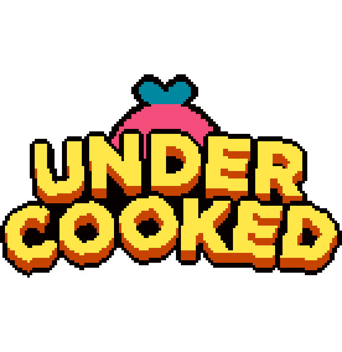

<table border="1">
 <tr>
    <td width="50%">
      
## About
- We created this project as the final requirements for the CSIT228 `Object Oriented Programming 2` Final Project in `Cebu Institute of Technology - University` located in Cebu City, Philippines. Consisted of 4 Contributors guided by Professor `Jay Vince Serato`.

## Contributors
- `Bolante, Val Mykel Ceven`
- `Benitez, Mars`
- `Cabili, Keiru Vent`
- `So, Alec Giuseppe`
      
## Requirements
- `IntelliJ` : Needed for running the base code.
- `jdk-17` or newer (`jdk-21` works).
- No database server needed anymore. Profiles, unlocked maps and personal bests are saved on the player's device, and the world leaderboard is online (see below).

## Platforms
- `intellij`: Main IDE to run the software.
- `core`: Main module with the application logic shared by all platforms.
- `lwjgl3`: Primary desktop platform using LWJGL3.
- `teavm`: Browser platform. TeaVM turns the Java code into JavaScript + WebGL.
- `supabase`: Hosts the online World Hall of Fame (top 10 per map).
- `aseprite`: Pixel art editor used for animation and static sprites.
- `tiled`: Mapping the whole maptile and tilesets.

## Assets
- `Modern Exteriors`: By LimeZu
- `Modern Interiors`: By LimeZu
- `Modern User Interface`: By LimeZu
- `8-bit Audio` : Free royalty audio from youtube.

   </td>
   <td>
     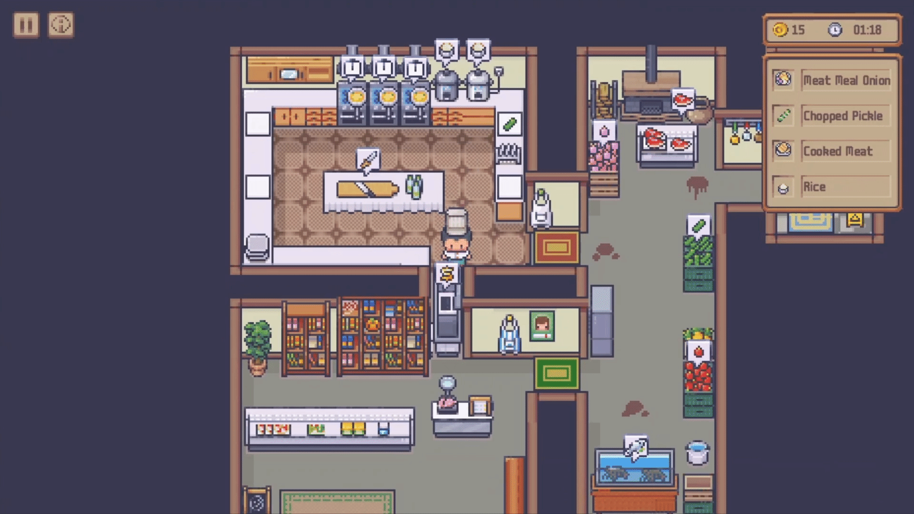
     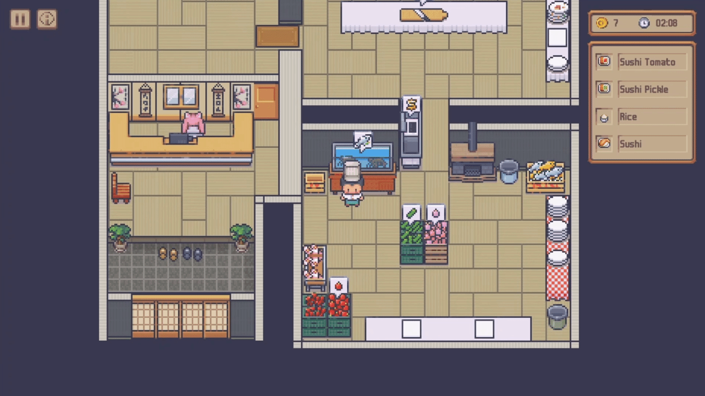
     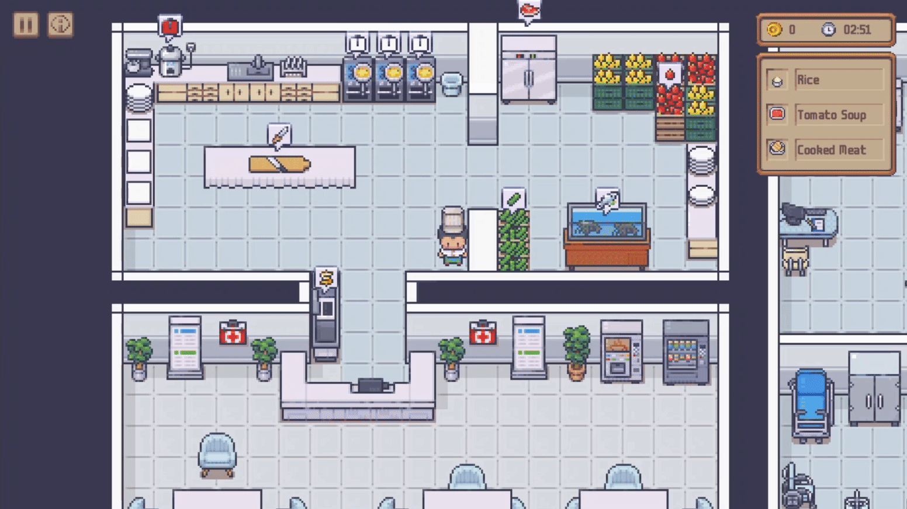
     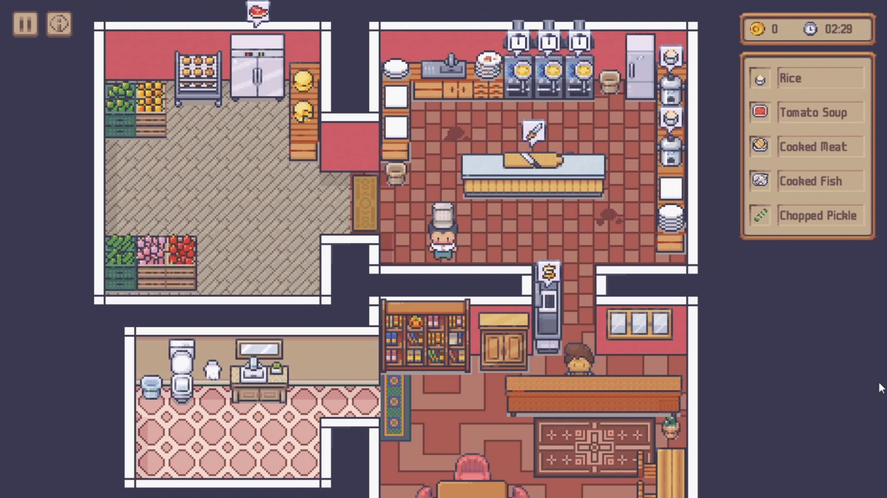 
     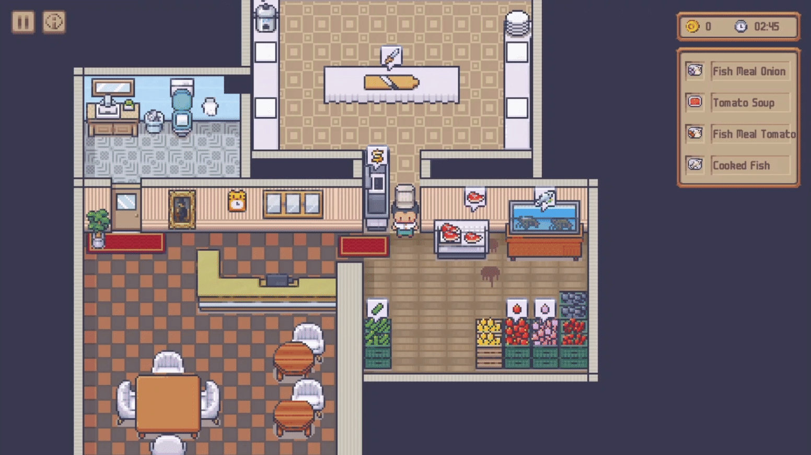
   </td>
 </tr>
 <tr>
 </tr>
</table>

  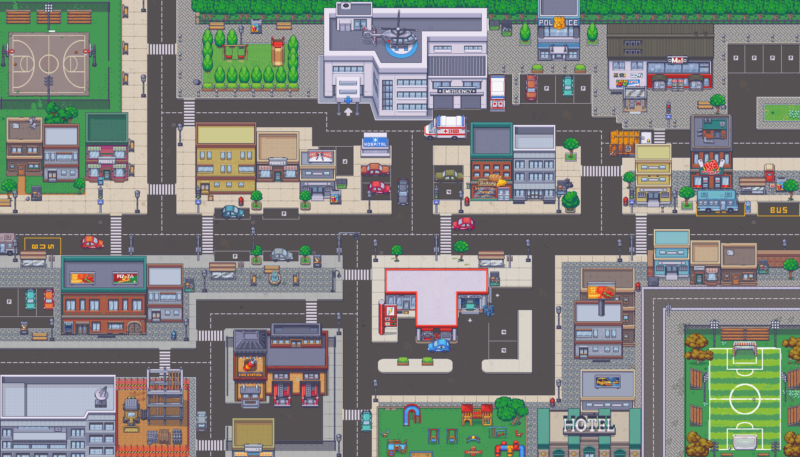

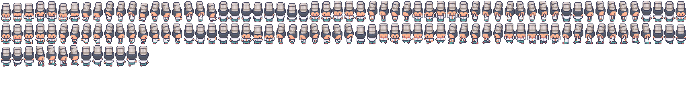

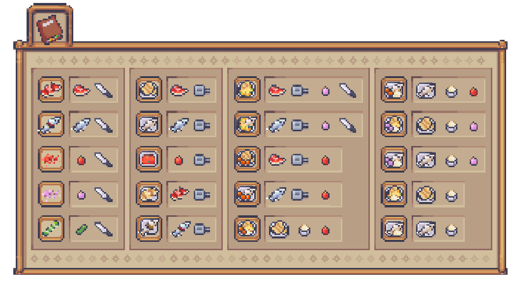
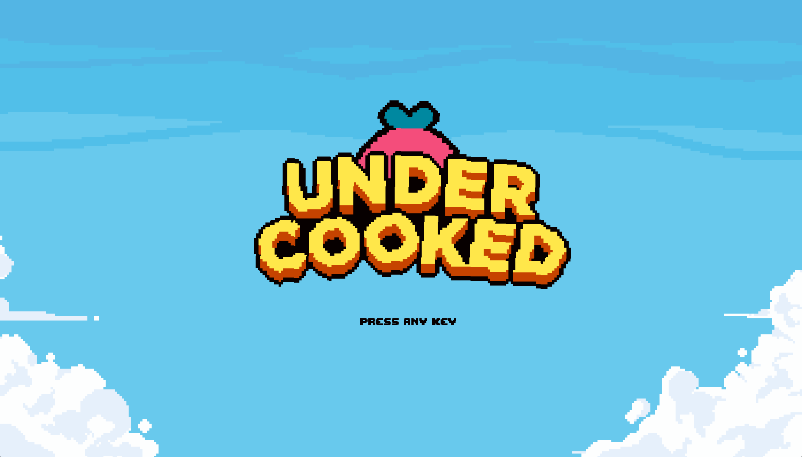

## 
## Gradle

This project uses [Gradle](https://gradle.org/) to manage dependencies.
The Gradle wrapper was included, so you can run Gradle tasks using `gradlew.bat` or `./gradlew` commands.
Useful Gradle tasks and flags:

- `--continue`: when using this flag, errors will not stop the tasks from running.
- `--daemon`: thanks to this flag, Gradle daemon will be used to run chosen tasks.
- `--offline`: when using this flag, cached dependency archives will be used.
- `--refresh-dependencies`: this flag forces validation of all dependencies. Useful for snapshot versions.
- `build`: builds sources and archives of every project.
- `cleanEclipse`: removes Eclipse project data.
- `cleanIdea`: removes IntelliJ project data.
- `clean`: removes `build` folders, which store compiled classes and built archives.
- `eclipse`: generates Eclipse project data.
- `idea`: generates IntelliJ project data.
- `lwjgl3:jar`: builds application's runnable jar, which can be found at `lwjgl3/build/lib`.
- `lwjgl3:run`: starts the application.
- `teavm:build`: builds the browser version into `teavm/build/dist/webapp`. To play it locally, serve that folder with any static web server, e.g. `npx serve teavm/build/dist/webapp`.
- `test`: runs unit tests (if any).

When running from IntelliJ, set the run configuration's working directory to the `assets` folder (asset paths are relative to it, which is what the browser version needs).

## Web version and leaderboard

- Every push to `master` builds the game with GitHub Actions (`.github/workflows/web.yml`) and publishes the finished site to the `web-build` branch. Render serves that branch as a static site and redeploys whenever it changes.
- The browser downloads all assets before the game starts, so keep `assets/` lean. Audio is MP3, and editor files (`.aseprite`, `.tpproj`, `github-icons/`) are left out of the web build.
- Saved data (`core/src/main/java/database/GameData.java`) uses libGDX `Preferences`: browser storage on the web, a file in your user folder on desktop.
- The World Hall of Fame (`database/Leaderboard.java`) calls two Supabase database functions over HTTP: `undercooked_submit_score` (keeps each player's best per map and rejects impossible scores) and `undercooked_top_scores`. The key in that file is Supabase's public "publishable" key; on its own it can only call those two functions.

Note that most tasks that are not specific to a single project can be run with `name:` prefix, where the `name` should be replaced with the ID of a specific project.
For example, `core:clean` removes `build` folder only from the `core` project.

  
  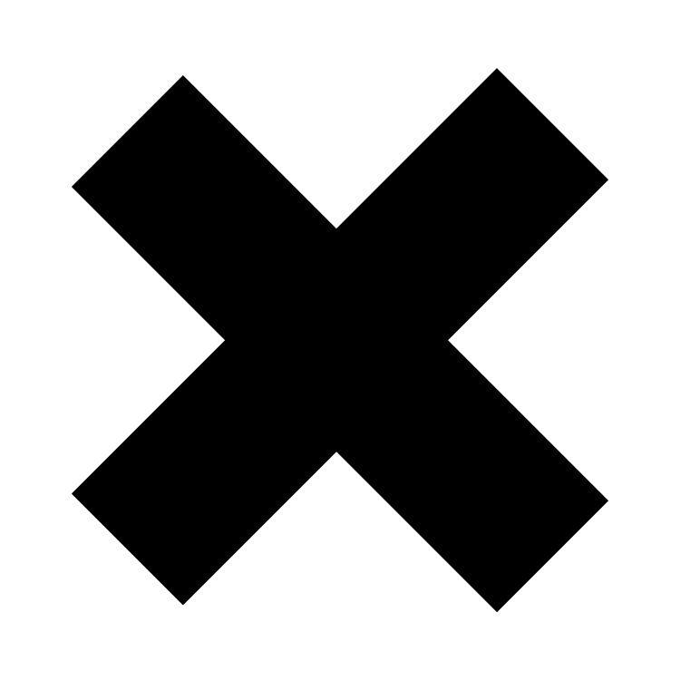
  
  
  
  

## License & Contributions 
- Huge thanks to <a href="https://limezu.itch.io/">LimeZu</a> with his `Modern Exteriors`, `Modern Interiors`, `Modern Ui Assets`. Most of the sprites in this project was created by `LimeZu` which played a huge role in contributing in this repository. When cloning in this repository, you automatically agree that your contribution cannot be distributed under LimeZu. You will not be able to revoke this right once your distribution has been distributed.

## Security
- Distributing a bundled assets of this repository has security implications, just like editing and altering sprites and using the same base code of this repository. Make sure you understand the implications before deciding to clone this repository.
  

